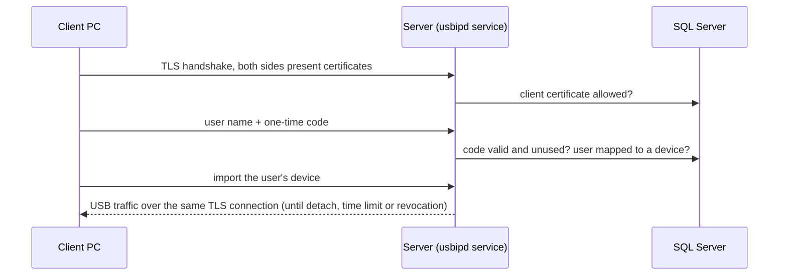

<!--
SPDX-FileCopyrightText: 2020 Frans van Dorsselaer
SPDX-FileCopyrightText: 2026 QSI-Banking

SPDX-License-Identifier: GPL-3.0-only
-->

# Remote USB server (usbipd)

Shares USB devices plugged into a Windows server, such as license dongles, with authenticated Windows clients.
Every connection uses mutual TLS. Each user is mapped to one device and signs in with a code from an authenticator app (TOTP).
The client is the [RemoteUsbEmulator-Client](https://github.com/QSI-Banking/RemoteUsbEmulator-Client) repository.

## How it works



- **SQL Server** holds binds, users, OTP secrets, allowed client certificates, attachments and the audit log.
- **`appsettings.json`** (next to `usbipd.exe`) holds the TLS port and certificates, the session limits and the connection string.
- A shared device is **bound** to the VBoxUSB driver, so the server itself cannot use it.

## Requirements

- Windows 10/11 or Windows Server, x64.
- SQL Server (Express is fine). The service connects with Windows authentication: `NT AUTHORITY\SYSTEM` for a local
  SQL Server, or the server's domain computer account (`DOMAIN\SERVER$`) for a remote one.
- Certificates, in the Local Computer stores:
  - a **CA** that issues the client certificates (Trusted Root or Intermediate store);
  - a **server certificate** with its private key (Personal store), whose DNS name the clients will use;
  - one **client certificate** per client PC, issued by that CA, with the Client Authentication purpose.
- One inbound TCP port (default 3241); the installer adds the firewall rule.

<details>
<summary>Creating test certificates (development only)</summary>

Use your own PKI in production. For a test setup, in an elevated PowerShell on the server:

```powershell
# CA
$ca = New-SelfSignedCertificate -Subject 'CN=usbip-dev-ca' -KeyUsage CertSign, CRLSign -KeyExportPolicy Exportable `
    -TextExtension @('2.5.29.19={critical}{text}ca=true') -CertStoreLocation Cert:\LocalMachine\My -NotAfter (Get-Date).AddYears(2)
Export-Certificate -Cert $ca -FilePath .\usbip-dev-ca.cer
Import-Certificate -FilePath .\usbip-dev-ca.cer -CertStoreLocation Cert:\LocalMachine\Root

# Server certificate (the DNS name is what clients enter as the server certificate name)
New-SelfSignedCertificate -Subject 'CN=usbip-dev-server' -DnsName 'usbip-dev-server' -Signer $ca `
    -TextExtension @('2.5.29.37={text}1.3.6.1.5.5.7.3.1') -CertStoreLocation Cert:\LocalMachine\My -NotAfter (Get-Date).AddYears(1)

# Client certificate, exported with its private key for the client PC
$client = New-SelfSignedCertificate -Subject 'CN=usbip-dev-client, O=USBIP Development' -Signer $ca -KeyExportPolicy Exportable `
    -TextExtension @('2.5.29.37={text}1.3.6.1.5.5.7.3.2') -CertStoreLocation Cert:\LocalMachine\My -NotAfter (Get-Date).AddYears(1)
$password = Read-Host -AsSecureString 'Password for the client .pfx'
Export-PfxCertificate -Cert $client -FilePath .\usbip-dev-client.pfx -Password $password
Remove-Item "Cert:\LocalMachine\My\$($client.Thumbprint)"
$client.Thumbprint   # for 'usbipd client add'
```

On the client PC, import `usbip-dev-ca.cer` into Local Computer > Trusted Root and `usbip-dev-client.pfx` into
Local Computer > Personal.

</details>

## Install

Run `usbipd-win_<version>_x64.msi` as an administrator. Its pages:

| Page | Field | Notes |
|---|---|---|
| Connection settings | TLS port | Default 3241. |
| | Session limit (minutes) | Hard limit per attach, 1 to 1440. Default 10. |
| | Server certificate | From Local Computer > Personal, with private key. |
| | Client certificate CA | The CA that issues client certificates. |
| Database | SQL Server, Database | For example `.\SQLEXPRESS` and `usbipd`. |
| | Trust the SQL Server certificate | Development only. |

Silent install: `msiexec /i usbipd-win_<version>_x64.msi /qn TLS_PORT=3241 TLS_SERVER_CERT=<thumbprint> TLS_CLIENT_CA=<thumbprint> SESSION_MAX_MINUTES=10 SQL_SERVER=.\SQLEXPRESS SQL_DATABASE=usbipd SQL_TRUST_SERVER_CERT=0`

To change settings later, edit `appsettings.json` and restart the service, or uninstall and install again.

## Initial setup

Run these in an elevated PowerShell. Every command that changes something shows a Windows sign-in dialog for a
local administrator; `usbipd admin` signs in once for several commands.

1. **Create the database**, as an account that may change the schema:
   `usbipd db migrate`
2. **Give SQL access**, in SQL Server (for example with `sqlcmd`):
   ```sql
   ALTER ROLE usbipd_service ADD MEMBER [NT AUTHORITY\SYSTEM];   -- or [DOMAIN\SERVER$] for a remote SQL Server
   ALTER ROLE usbipd_admin ADD MEMBER [DOMAIN\usbipd-admins];    -- the administrators who run usbipd
   ```
   Grant `usbipd_admin` to the administrators' accounts or groups directly, not through `BUILTIN\Administrators`.
3. **Allow the client certificates**:
   `usbipd client add --certificate C:\certs\pc42.cer --name PC42` (or `--thumbprint <SHA-1>`)
4. **Share devices**: `usbipd list`, then `usbipd bind --busid <BUSID>`.
5. **Add users**: `usbipd user add --name alice --busid <BUSID>`. A QR code is shown once; scan it with the user's
   authenticator app (Microsoft Authenticator, Google Authenticator and others).
6. **Check**: `usbipd list`, `usbipd user list`, `usbipd client list`, then attach from a client.

## Ongoing use

| Task | Command |
|---|---|
| After every service start (also after a reboot) | `usbipd bind --review` |
| Several changes with one sign-in | `usbipd admin` |
| Share a device / stop sharing | `usbipd bind --busid <BUSID>` / `usbipd unbind --busid <BUSID>` |
| Add a user or move them to another device | `usbipd user add --name <NAME> --busid <BUSID> [--force]` |
| Remove a user | `usbipd user remove --name <NAME>` |
| Lost or new phone | `usbipd user otp reset --name <NAME>` |
| Allow, disable or remove a client PC | `usbipd client add / disable / enable / remove` |
| End a session now | `usbipd detach --busid <BUSID>` |
| See devices, users, clients | `usbipd list`, `usbipd user list`, `usbipd client list` |

Device states in `usbipd list`:

- **Shared**: can be attached.
- **Needs review**: the service restarted since the bind was confirmed; run `usbipd bind --review`.
- **Quarantined**: the device was unplugged, moved or re-enumerated, so its bind was dropped. It stays on the VBoxUSB
  driver. Run `usbipd bind` to share it again after checking it is the right device, or `usbipd unbind` to give it
  back to Windows.
- **Needs bind (driver lost)**: the device is no longer on the VBoxUSB driver; unbind and bind it again.

## Security

- **Mutual TLS** on every connection. A client needs a certificate from the configured CA that is also enabled in
  `usbipd client list`. Disabling or removing a certificate ends its sessions within seconds.
- **Users** sign in with a 6-digit TOTP code; each code works once. A user can only attach the one device mapped to them.
- **Sessions** end at the time limit, when an administrator detaches, unbinds or remaps, removes the user, or disables
  the client certificate. Clients never reconnect by themselves; a new session needs a new code.
- **Binds** are valid only while the service watches the device without a break: any unplug, move or re-enumeration
  drops the bind, every service start requires a review, and every attach checks the device against what was recorded
  at bind time (port and a fingerprint of its USB descriptors).
- **Administration** requires a local administrator's sign-in for every change, also in an elevated window. The
  database connection runs as that person, and every change is written to `usbipd.AdminAudit`.
- **No attaches** while the database cannot be reached.

Known limits:

- OTP secrets are stored unencrypted in SQL Server for now. Restrict who can read the database and its backups.
- A device without a USB serial number is identified by its port, and a programmable device can copy another device's
  descriptors. Keep the servers and their USB ports physically secured.
- The client driver is test-signed for now (see the client README).

## Troubleshooting

| The client says | Meaning | What to do |
|---|---|---|
| Authentication failed | Unknown user, wrong code, or a code that was already used | Wait for the next code; check the phone's clock |
| No device is bound to user | The user is not mapped to a device on this server | `usbipd user add` |
| Cannot be attached until an administrator checks it | Needs review, quarantined, not shared, or not present | `usbipd list`, then `bind --review` or `bind` |
| Server unavailable | The service cannot reach SQL Server | Check SQL Server and the service's SQL access |
| Device busy | Another session holds the device | `usbipd detach` if needed |
| Connection or TLS failure | Certificate not allowed, wrong server name or pin, port blocked | `usbipd client list`; check the client's settings |

The service log explains every refusal. It is in Event Viewer under **Applications and Services Logs > usbipd >
Operational**, or in PowerShell:

```powershell
Get-WinEvent -LogName usbipd/Operational -MaxEvents 30 | Format-Table TimeCreated, Id, LevelDisplayName, Message -Wrap
```

For debug detail as well, stop the service and run it in an elevated console:
`Stop-Service usbipd; usbipd server` (Ctrl+C, then `Start-Service usbipd`).

## Configuration reference

`appsettings.json` next to `usbipd.exe`:

| Key | Default | Meaning |
|---|---|---|
| `ConnectionStrings:Usbipd` | | SQL Server connection string (Windows authentication) |
| `usbipd:Tls:Port` | 3241 | TLS port |
| `usbipd:Tls:ListenAddress` | all | Listen on one local address only |
| `usbipd:Tls:ServerCertificateThumbprint` | | Server certificate in Local Computer > Personal |
| `usbipd:Tls:ClientCaThumbprints` | | CAs that may issue client certificates |
| `usbipd:Tls:HandshakeTimeoutSeconds` | 10 | |
| `usbipd:Tls:RevocationMode` | NoCheck | `NoCheck`, `Online` or `Offline` for client certificates |
| `usbipd:Otp:Issuer` | QSI USB/IP | Name shown in authenticator apps |
| `usbipd:Session:MaxDurationMinutes` | 10 | Hard limit per attach |
| `usbipd:Session:ImportTimeoutSeconds` | 10 | Time between sign-in and import |
| `usbipd:Session:RecheckIntervalSeconds` | 2 | How often active sessions are re-checked |

## Building from source

The .NET 10 SDK (or Visual Studio with it), and WiX 7 for the installer. The platform must be given explicitly:

```powershell
dotnet build usbipd-win.slnx -c Release -p:Platform=x64
dotnet test UnitTests\UnitTests.csproj -p:Platform=x64
dotnet publish Usbipd\Usbipd.csproj -c Release -p:PublishProfile=x64
```

Schema changes are EF Core migrations in `Usbipd\Data\Migrations`:

```powershell
$env:EfDesign = 'true'; $env:Platform = 'x64'
dotnet ef migrations add <Name> --project Usbipd\Usbipd.csproj --output-dir Data\Migrations
dotnet ef migrations script --idempotent --project Usbipd\Usbipd.csproj -o Database\usbipd.sql   # for DBAs
```

Test plan: [TESTING.md](TESTING.md).

## Credits and license

Based on [usbipd-win](https://github.com/dorssel/usbipd-win) by Frans van Dorsselaer and contributors, which uses the
VirtualBox USB drivers. Licensed under the GNU General Public License v3.0; see [COPYING.md](COPYING.md) and
[LICENSES](LICENSES).
